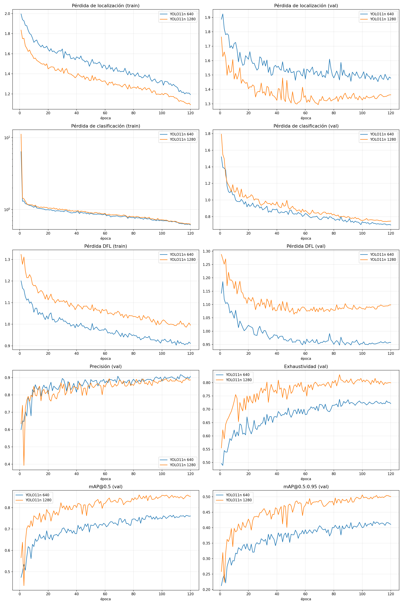
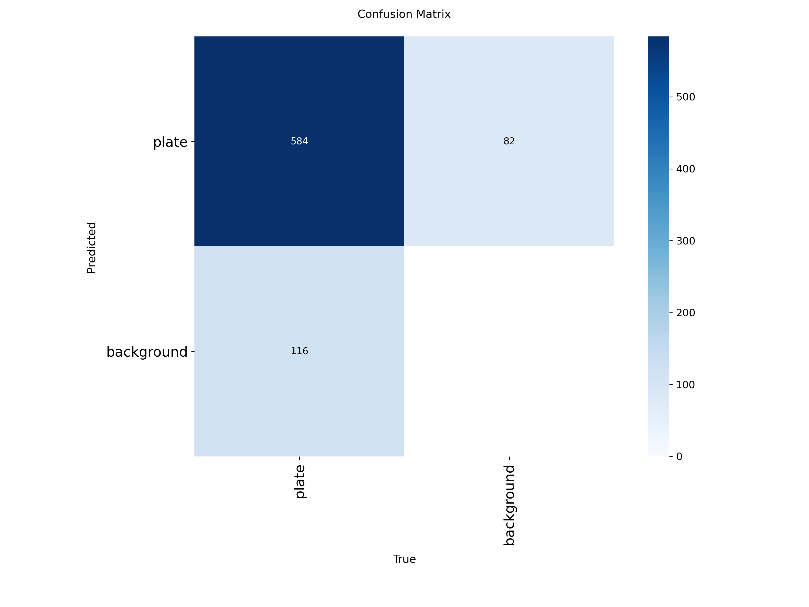
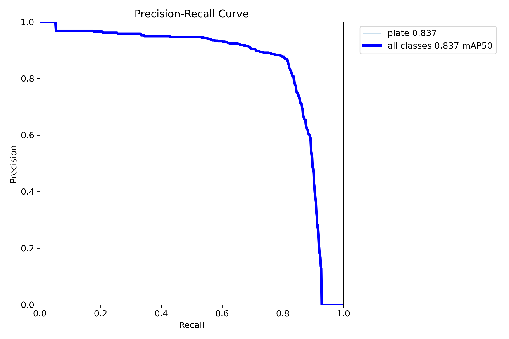
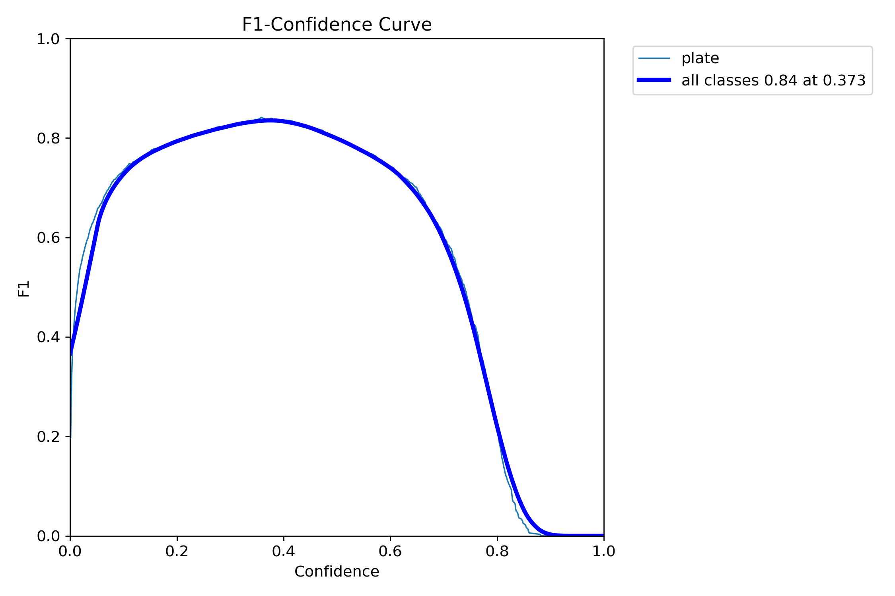

# Práctica 4 · Detección y reconocimiento

---

En esta práctica se aborda la detección y reconocimiento de matrículas, así como la detección de personas y vehículos mediante técnicas de visión por computador y aprendizaje profundo.

En primer lugar, se utiliza el modelo YOLO para la detección de personas y vehículos. Posteriormente, se entrena un modelo específico de YOLO para la detección de matrículas, cuyos resultados se emplean como base para desarrollar y evaluar diferentes métodos de reconocimiento de caracteres. En particular, se realiza una comparación entre los sistemas tradicionales de OCR (Optical Character Recognition) y los modelos VLM (Vision Language Models) para analizar su capacidad de lectura de matrículas.

Además, se desarrolla un sistema de lectura automática de matrículas que integra la detección mediante YOLO con el reconocimiento de texto mediante OCR.

Como ampliación del trabajo, se realizan dos tareas adicionales:

- Detección con RT-DETR: se entrena un modelo basado en esta arquitectura para la detección de matrículas y se comparan sus resultados con los obtenidos mediante YOLO.
- Anonimización de personas y matrículas: se implementa un sistema que aplica filtros sobre las regiones detectadas, permitiendo ocultar estos elementos en imágenes y vídeos.

---

## Índice

1. [Detección de personas y vehículos con YOLO](#1-detección-de-personas-y-vehículos-con-yolo)
2. [Detección de matrículas](#2-detección-de-matrículas)
3. [Reconocimiento de matrículas](#3-reconocimiento-de-matrículas)
4. [Resultados](#4-resultados)
5. [Anonimización de personas y matrículas](#5-anonimización-de-personas-y-matrículas)
6. [Especificaciones del equipo](#6-especificaciones-del-equipo)

---

## 1. Detección de personas y vehículos con YOLO

En esta primera parte se hace uso del modelo **YOLO11n** de Ultralytics para la detección y seguimiento de personas y vehículos. El objetivo es identificar estos elementos en cada fotograma del [vídeo de ejemplo proporcionado para la práctica](https://ulpgc-my.sharepoint.com/personal/mcastrillon_iusiani_ulpgc_es/_layouts/15/stream.aspx?id=%2Fpersonal%2Fmcastrillon%5Fiusiani%5Fulpgc%5Fes%2FDocuments%2FRecordings%2FC0142%2EMP4&ga=1&share=cQp0bJ6%2DGLkPQq4XHpEzwA%5FGEgUCbGUicnP93So3tDpcv8c50Q&referrer=StreamWebApp%2EWeb&referrerScenario=AddressBarCopied%2Eview%2E3e3bece3%2Dd245%2D4d98%2D911d%2D54c2b09bd5e2) y mantener su seguimiento a lo largo de este.

Para realizar la detección se utiliza YOLO11n, una variante ligera de la arquitectura YOLO11 que permite detectar objetos de forma eficiente. El modelo identifica las clases correspondientes a personas y vehículos, obteniendo para cada detección su clase, nivel de confianza y caja delimitadora (bounding box).

Para el seguimiento de los objetos detectados se utiliza BoT-SORT, un algoritmo de seguimiento multiobjeto (Multi-Object Tracking). Su utilización resulta especialmente relevante en las últimas partes del vídeo, donde aparecen vehículos estacionados y otros vehículos circulan por delante de ellos. Esta situación dificulta el seguimiento y puede provocar la pérdida de identificadores (IDs) cuando se producen oclusiones.

Para mejorar el comportamiento del tracker ante estas situaciones, se utiliza un archivo de configuración personalizado, [`custom_botsort.yaml`](./custom_botsort.yaml), en el que se ajustan sus parámetros. Los principales ajustes realizados son:

- **Persistencia de los identificadores (track_buffer=300)**: aumenta el número de fotogramas durante los que se conserva un seguimiento perdido antes de eliminarlo. Esto permite recuperar identificadores cuando un vehículo queda oculto temporalmente.
- **Asociación de detecciones (match_thresh=0.85)**: establece el umbral utilizado durante el proceso de asociación entre detecciones y seguimientos existentes.
- **Compensación del movimiento de cámara (gmc_method=sparseOptFlow)**: utiliza flujo óptico disperso para estimar y compensar los movimientos de la cámara, mejorando la asociación de objetos entre fotogramas.
- **Reidentificación por apariencia (with_reid=True)**: habilita el uso de características visuales para ayudar a identificar objetos que han desaparecido temporalmente de la imagen.
- **Umbral de similitud de apariencia (appearance_thresh=0.25)**: establece el nivel de similitud requerido para considerar que dos detecciones corresponden al mismo objeto.
- **Umbral de proximidad (proximity_thresh=0.5)**: controla la proximidad espacial necesaria para considerar la información de apariencia durante la asociación.
Además, se utiliza **model=auto** para aprovechar las características extraídas por el propio modelo YOLO durante la reidentificación, evitando cargar un modelo externo adicional.

---

## 2. Detección de matrículas

En esta sección se aborda el entrenamiento de modelos específicos para la detección de matrículas. Para ello, se utilizan dos arquitecturas diferentes, **YOLO** y **RT-DETR**, con el objetivo de comparar su rendimiento en esta tarea.

### Conjunto de datos
El conjunto de datos, al cual se puede accede desde este [enlace](https://drive.google.com/drive/folders/1RFd6sKH_QMQcpE_w5rWmy8rKiYUY5_SI) contiene **2418 imágenes** recopiladas una a una con matrículas etiquetadas manualmente en formato **YOLO**. Para el entrenamiento, se han utilizado 2387 imágenes ya que cuando se comenzó con el entranmiento no estaban todas las imágenes disponibles, este dataset se dividió en:

| Partición | Imágenes | Matrículas | Porcentaje |
|---|---|---|---|
| Entrenamiento | 1670 | 3244 | 70% |
| Validación | 358 | 712 | 15% |
| Test | 359 | 700 | 15% |
| **Total** | **2387** | **4656** | 100% |

**YOLO11n** se entrena directamente con anotaciones YOLO. RT-DETR (implementación de Baidu) necesita anotaciones en **formato COCO** para poder entrenar. La conversión se hace con el script [`yolo_a_coco.py`](./yolo_a_coco.py).

### Entrenamiento

| Parámetro | YOLO11n | Decisión y efecto |
|---|---|---|
| Modelo base | `yolo11n.pt` (preentrenado en COCO) | Se hace *fine-tuning*: el modelo ya sabe detectar objetos y solo aprende a detectar matrículas. |
| Épocas | 120 | Máximo de épocas. |
| *Early stopping* | 20 épocas (`PATIENCE`) | Si el mAP en validación no mejora en 20 épocas, se detiene el entrenamiento. |
| Resolución (`IMGSZ`) | 1280 (y 640 para comparar) | Las matrículas ocupan una parte muy pequeña de la imagen. A más resolución, más píxeles tiene cada matrícula. |
| Lote (`BATCH`) | 8 | Fijo para no superar los 6 GB de VRAM de la GPU a 1280. |
| Semilla | 42 | La división train/val/test es siempre la misma. |
| Pesos finales | `best.pt` | Se guarda la época con mejor resultado en validación, no la última. |

Otras decisiones sobre los datos:
- **Se descartan las matrículas con un ancho menor al 1 % del de la imagen** (`MIN_ANCHO_REL = 0.01`): son ilegibles y enseñarían al modelo a buscar matrículas que ni siquiera se pueden leer.
- **Las imágenes se guardan con el lado mayor reducido a 1280 px**, la resolución de entrenamiento. Así no se cargan imágenes más grandes de lo que el modelo va a usar.

Se entrenaron dos modelos YOLO11n con la misma configuración y solo distinta resolución: **1280** (el que se usa en el vídeo) y **640** (la misma resolución que RT-DETR, para que la comparación entre los dos sea justa).

#### Análisis del entrenamiento de YOLO

Cada fila de la figura muestra una variable: a la izquierda se calcula sobre las imágenes de entrenamiento (train) y a la derecha sobre las de validación (val), al final de cada época. Las cuatro últimas gráficas son las métricas en validación. La pérdida de clasificación de train está en escala logarítmica, porque su valor en la primera época es mucho mayor que el resto.

**Qué mide cada gráfica:**

- **Pérdida de localización (box_loss):** cuánto se diferencian las cajas predichas de las reales, a partir de su solape (IoU). Cuanto más baja, mejor ajustadas están las cajas.
- **Pérdida de clasificación (cls_loss):** cuánto se equivoca el modelo al decidir si en una zona hay una matrícula o es fondo, es decir, al asignar la confianza.
- **Pérdida DFL (Distribution Focal Loss):** afina la posición exacta de cada borde de la caja. El modelo predice para cada borde una distribución de posibles posiciones, y esta pérdida es baja cuando esa distribución se concentra en la posición real.
- **Precisión (val):** de todas las detecciones del modelo, qué proporción son matrículas reales. Ultralytics la calcula con el umbral de confianza que maximiza F1.
- **Exhaustividad (val):** de todas las matrículas reales, qué proporción detecta el modelo. Se calcula con el mismo umbral que la precisión.
- **mAP@0.5 (val):** área bajo la curva precisión-exhaustividad, contando una detección como correcta si su IoU con la caja real es al menos 0.5. Resume el detector con todos los umbrales de confianza a la vez.
- **mAP@0.5:0.95 (val):** media del mAP con umbrales de IoU de 0.5 a 0.95. Exige cajas cada vez más ajustadas, así que además de si encuentra la matrícula, mide lo bien colocada que está la caja.

En train, las pérdidas se calculan sobre imágenes con aumento de datos, y en val sobre imágenes sin modificar, que el modelo no usa para aprender. Comparar las dos permite detectar el **sobreajuste**: si la pérdida de train sigue bajando mientras la de val se estanca o sube, el modelo está aprendiendo detalles de las imágenes de entrenamiento que no le sirven para imágenes nuevas.

**Análisis**

*Pérdidas de entrenamiento.* Las tres pérdidas de train bajan en los dos modelos hasta la última época. En la pérdida de localización, la bajada se vuelve más pronunciada en las 10 últimas épocas, lo que coincide con que Ultralytics desactiva el aumento de datos por mosaico al final del entrenamiento (`close_mosaic: 10` en `args.yaml`). Las imágenes de entrenamiento se vuelven más sencillas y la pérdida baja. La pérdida de clasificación de train es muy alta en la primera época y cae de golpe en la segunda, en los dos modelos. La cabeza de clasificación se crea nueva al pasar de las 80 clases del dataset COCO (con el que se preentrenó `yolo11n.pt`) a una sola (matrícula) y aprende muy rápido a distinguir la matrícula del fondo. Desde la segunda época, las curvas de los dos modelos casi se superponen y bajan de forma continua.

*Pérdidas de validación y sobreajuste.* La pérdida de clasificación de val baja hasta el final en los dos modelos. Las pérdidas de localización y DFL de val se comportan distinto según la resolución:
- En el **modelo de 640**, bajan hasta la época 60 aproximadamente y después se mantienen planas hasta el final (en torno a 1,5 y 0,96).
- En el **modelo de 1280**, alcanzan su mínimo entre las épocas 50 y 70 (en torno a 1,3 y 1,08) y después suben ligeramente (en torno a 1,35 y 1,10). Mientras tanto, las de train siguen bajando. Esto indica un **sobreajuste leve** en la localización de las cajas: el modelo aprende detalles de las imágenes de entrenamiento que no le sirven para imágenes nuevas.

Aun así, ninguna métrica de validación empeora en esas épocas, así que el sobreajuste no llega a afectar a la detección. Además, como se guarda la época con mejor resultado en validación (`best.pt`), no se usa un modelo sobreajustado.

*Métricas de validación.* En las primeras épocas, el modelo de 1280 tiene una caída brusca: la precisión baja hasta cerca de 0,4 y el mAP@0.5 hasta cerca de 0,43. Después se recupera, y a partir de la época 20, aproximadamente, la precisión de los dos modelos está en torno a 0,85. Desde ahí sube lentamente hasta en torno a 0,88-0,90, con las dos curvas casi superpuestas. En cambio, la exhaustividad del modelo de 1280 queda por encima durante todo el entrenamiento y termina en torno a 0,80, frente a 0,72 del de 640. Lo mismo ocurre con el mAP@0.5 (en torno a 0,85 frente a 0,76) y el mAP@0.5:0.95 (en torno a 0,50 frente a 0,41). En las últimas épocas, la exhaustividad y los dos mAP están prácticamente estabilizados en los dos modelos.

*Comparación entre resoluciones.* Las pérdidas no sirven para comparar los dos modelos, porque cada uno trabaja con imágenes y cajas de distinto tamaño. Por ejemplo, el modelo de 640 tiene menor pérdida DFL y menor pérdida de clasificación de val que el de 1280, pero peores métricas. La comparación se hace con las métricas, y muestran que las dos resoluciones tienen una precisión parecida (cometen una proporción parecida de falsas detecciones) y que la diferencia está en la exhaustividad. A 640, las matrículas pequeñas tienen tan pocos píxeles que el modelo no llega a detectarlas. En los dos modelos la precisión queda por encima de la exhaustividad, así que el error principal es no detectar matrículas, más que detectar cosas que no lo son. Por eso en el vídeo se usa el modelo de 1280.

**Resultado de cada entrenamiento** (mejor época según mAP@0.5:0.95 en validación):

| Modelo | Épocas entrenadas | Mejor época | mAP@0.5 (val) | mAP@0.5:0.95 (val) |
|---|---|---|---|---|
| YOLO11n 640 | 120 | 108 | 0.76476 | 0.41982 | 
| YOLO11n 1280 | 120 | 100 | 0.85974 | 0.50583 |

Los dos modelos completaron las 120 épocas. Su mejor resultado en validación se alcanza cerca del final (época 108 en el de 640 y época 100 en el de 1280). A partir de ahí las métricas se mantienen estables, sin superar ese máximo y sin empeorar. El *early stopping* no llegó a activarse, porque necesita 20 épocas seguidas sin mejora y el entrenamiento terminó antes de que se cumplieran. El modelo que se guarda (`best.pt`) es el de esa mejor época. En validación, el modelo de 1280 supera al de 640 tanto en mAP@0.5 (0.860 frente a 0.765) como en mAP@0.5:0.95 (0.506 frente a 0.420).

### Evaluación en test

#### YOLO11n a 1280

Métricas calculadas con Ultralytics en validación y test (umbral de confianza de uso: 0.35):

| Métrica | Validación | Test |
|---|---|---|
| Imágenes | 358 | 359 |
| Matrículas reales | 712 | 700 |
| Precisión | 0.882 | 0.873 |
| Exhaustividad (recall) | 0.803 | 0.806 |
| F1 | 0.841 | 0.838 |
| mAP@0.5 | 0.853 | 0.837 |
| mAP@0.5:0.95 | 0.510 | 0.493 |
| TP (conf = 0.35) | 594 | 584 |
| FP (conf = 0.35) | 81 | 82 |
| FN (conf = 0.35) | 118 | 116 |
| Precisión (conf = 0.35) | 0.880 | 0.877 |
| Exhaustividad (conf = 0.35) | 0.834 | 0.834 |
| F1 (conf = 0.35) | 0.857 | 0.855 |
| Inferencia (ms/img) | 14.398 | 14.461 |

TP (verdaderos positivos) son las matrículas detectadas correctamente, FP (falsos positivos) las detecciones donde no hay ninguna matrícula y FN (falsos negativos) las matrículas reales que el modelo no detecta. Las filas con "conf = 0.35" se calculan aceptando solo las detecciones con una confianza de al menos 0.35, el umbral de uso del modelo. El resto de métricas las calcula Ultralytics con el umbral que maximiza F1, salvo los mAP, que no dependen del umbral.

Los resultados en validación y en test son muy parecidos: la mayor diferencia está en el mAP@0.5 (0.853 frente a 0.837) y en el mAP@0.5:0.95 (0.510 frente a 0.493), y con el umbral de 0.35 la exhaustividad es idéntica (0.834). Que test quede ligeramente por debajo es lo esperado. El conjunto de validación se usó para elegir la mejor época, es decir, el modelo final se seleccionó por ser el que mejor funcionaba en esas imágenes. Por eso su resultado en validación tiende a ser algo mayor que el que obtiene con imágenes nuevas. Las imágenes de test, en cambio, no han intervenido en el entrenamiento. Como la diferencia entre los dos conjuntos es pequeña, el modelo generaliza a imágenes que no ha visto, y los resultados de test representan cómo funcionará el detector en la práctica.

La matriz de confusión muestra los resultados en test con el umbral de confianza de 0.35. Las filas indican lo que predijo el modelo (*Predicted*) y las columnas lo que había realmente en la imagen (*True*):

- **584 (plate / plate):** matrículas que el modelo detectó correctamente (verdaderos positivos, TP).
- **116 (background / plate):** matrículas reales que el modelo no detectó y tomó como fondo (falsos negativos, FN).
- **82 (plate / background):** detecciones del modelo en zonas donde no había ninguna matrícula (falsos positivos, FP).
- **Casilla vacía (background / background):** en detección no se cuentan los aciertos de fondo, porque el fondo es todo lo que no es una matrícula y no se puede contar como objetos.

De las 700 matrículas de test, el modelo detecta 584 (exhaustividad de 0.834). De sus 666 detecciones, 584 son correctas (precisión de 0.877). Hay más matrículas sin detectar (116) que detecciones falsas (82), igual que en el entrenamiento, donde la precisión quedaba por encima de la exhaustividad: el error principal del modelo es no detectar matrículas.

**Curva precisión-exhaustividad.** Cada punto corresponde a un umbral de confianza: al bajarlo, el modelo detecta más matrículas (más exhaustividad) pero comete más errores (menos precisión). En nuestro modelo, la precisión se mantiene en torno a 0,9 hasta una exhaustividad de 0,8, es decir, las detecciones con confianza media y alta son casi siempre correctas. A partir de ahí la curva cae de golpe: para encontrar más matrículas habría que aceptar detecciones de confianza muy baja, en su mayoría falsas. La curva termina en una exhaustividad de en torno a 0,93, así que en torno al 7 % de las matrículas no se detectan con ningún umbral. El área bajo la curva es el mAP@0.5 en test: 0.837.

**Curva F1-confianza.** Muestra el F1 (equilibrio entre precisión y exhaustividad) para cada umbral. El máximo es **0.84 con un umbral de 0.373**, y la curva es bastante plana a su alrededor (F1 por encima de 0,8 entre umbrales de 0,2 y 0,55, aproximadamente), así que el resultado no depende mucho del umbral exacto. Con umbrales muy bajos el F1 baja por las detecciones falsas, y con umbrales por encima de 0,6 cae rápidamente porque el modelo descarta la mayoría de las matrículas. El umbral de uso, 0.35, está en la zona plana y muy cerca del máximo, lo que justifica haberlo elegido.

**Exhaustividad según el tamaño de la matrícula** (ancho en píxeles a la resolución de entrada del modelo, en test, con conf = 0.35):

| Tamaño | Exhaustividad | Matrículas |
|---|---|---|
| <20 px | 0.520 | 148 |
| 20-40 px | 0.860 | 171 |
| 40-80 px | 0.864 | 169 |
| >80 px | 0.953 | 212 |

La exhaustividad depende del tamaño de la matrícula. Las de menos de 20 px de ancho son el caso más difícil: el modelo solo detecta la mitad (0.520). A partir de 20 px la exhaustividad sube a 0.860, y con más de 80 px llega a 0.953. Las matrículas pequeñas son, por tanto, la principal causa de las matrículas no detectadas que se ven en la matriz de confusión y en la curva precisión-exhaustividad.

Esto también explica la diferencia con el modelo de 640. Los tamaños de la tabla están medidos a la resolución de entrada del modelo (1280), así que a 640 cada matrícula mide la mitad de píxeles: las de 20 a 40 px pasarían a estar por debajo de 20 px, el grupo en el que el modelo falla más. Por eso entrenar y detectar a 1280 mejora sobre todo la exhaustividad.

#### Efecto de la resolución: YOLO11n a 640 frente a 1280

Métricas en test calculadas con el mismo código para los dos modelos (cada uno con su umbral de confianza óptimo):

| Modelo | mAP@0.5 | mAP@0.5:0.95 | mejor F1 | conf óptima | precisión | exhaustividad | TP | FP | FN | ms/imagen |
|---|---|---|---|---|---|---|---|---|---|---|
| YOLO11n (640) | 0.734 | 0.403 | 0.794 | 0.308 | 0.854 | 0.743 | 520 | 89 | 180 | 9.315 |
| YOLO11n (1280) | 0.838 | 0.496 | 0.839 | 0.366 | 0.866 | 0.814 | 570 | 88 | 130 | 18.526 |

Pasar de 640 a 1280 sube el mAP@0.5 de 0.734 a 0.838 y el mAP@0.5:0.95 de 0.403 a 0.496. La mejora viene sobre todo de la **exhaustividad**, que pasa de 0.743 a 0.814: el modelo de 1280 detecta 50 matrículas más (de 520 a 570 TP). En cambio, la precisión apenas cambia (0.854 frente a 0.866) y las falsas detecciones son prácticamente las mismas (89 frente a 88 FP). Esto coincide con lo que se veía en el entrenamiento y en la tabla por tamaños: más resolución sirve para encontrar las matrículas pequeñas, no para evitar falsos positivos. El coste es el **tiempo de inferencia**, que casi se duplica (de 9.315 a 18.526 ms por imagen).

En el vídeo se usa el modelo de **1280**, porque detecta más matrículas con la misma precisión. El tiempo extra sigue siendo bajo para procesar vídeo.

---

## 3. Reconocimiento de matrículas

En esta sección se lleva acabo la lectura de matrículas haciendo uso de OCR y VLM. Para ello se realiza la comparación tres modelos: **EasyOCR**, **PaddleOCR** y **SmolVLM** evaluando las mismas matrículas recortadas del dataset (a partir de las cajas anotadas). El código y detalles de la comparación se encuentra en el archivo [`OCR_vs_VLM`](./OCR_vs_VLM.ipynb).

### Resultados

| Modelo | Tasa de acierto | Precisión de caracteres | Sin Lectura | Tiempo medio (ms) | Tiempo mediana (ms) | Matrículas por segundo |
|---|---|---|---|---|---|---|
| EasyOCR | 0.553 | 0.711 | 0.240 | 20.504 | 15.415 | 48.772 |
| PaddleOCR | 0.898 | 0.931 | 0.055 | 17.778 | 14.730 | 56.249 |
| SmolVLM | 0.727 | 0.850 | 0.119 | 810.030 | 571.460 | 1.235 |

Métricas:

- **Tasa de acierto:** proporción de matrículas leídas completamente bien. Una lectura con un solo carácter mal cuenta como fallo.
- **Precisión de caracteres:** proporción media de caracteres leídos correctamente. Se calcula como 1 - CER, donde el CER (tasa de error por carácter) es el número de caracteres que hay que cambiar, quitar o añadir para convertir la lectura en la matrícula real, dividido entre la longitud de la matrícula real. A diferencia de tasa de acierto, tiene en cuenta las lecturas que fallan solo en algún carácter.
- **Sin Lectura:** proporción de matrículas en las que el modelo no devolvió ninguna matrícula con formato válido (no leyó nada o lo que leyó no encaja con el formato de matrícula).
- **Tiempo medio (ms):** tiempo medio de lectura por matrícula, en milisegundos.
- **Tiempo mediana (ms):** mediana del tiempo de lectura por matrícula. Es menos sensible que la media a los casos que tardan mucho más de lo normal.
- **Matrículas por segundo:** matrículas que el modelo puede leer por segundo (1000 / tiempo_medio_ms).

### Análisis

**PaddleOCR es el mejor en todas las columnas:** tiene la mayor tasa de acierto (0.898) y precisión de caracteres (0.931), la menor sin lectura (0.055) y el menor tiempo (14.730 ms de mediana). Estos resultado concuerdan con el modelo, ya que se trata de un OCR especializado en leer texto en imágenes, exactamente la tarea propuesta.

EasyOCR es casi igual de rápido que PaddleOCR, pero mucho menos preciso con menor tasa de acierto (0.553). Gran parte de sus fallos vienen de matrículas sin lectura (0.240): en una de cada cuatro matrículas no devuelve una matrícula válida. Si le falta o le sobra un solo carácter, el texto ya no encaja con el formato de matrícula y se descarta. En cuanto a SmolVLM, queda en medio en precisión con una tasa de acierto de 0.727, pero su precisión de caracteres (0.850) es bastante mayor. Esto indica que muchos de sus fallos son de pocos caracteres. Su gran problema es el tiempo: 571.460 ms de mediana frente a unos 15 ms de los OCR. Tiene sentido, porque un VLM es un modelo de lenguaje mucho más grande que genera la respuesta token a token. Además, su tiempo medio (810.030 ms) es mucho mayor que su mediana, así que algunas lecturas tardan bastante más que el resto.

En conclusión **PaddleOCR** es la mejor opción para en el vídeo de la práctica, debido a su gran precisión y rápidez. SmolVLM tiene la ventaja de no necesitar un modelo específico, pero con 1.235 matrículas por segundo no es viable para procesar vídeo y mucho menos si lo quisiéramos utilizar en una detección en tiempo real. Para la tarea concreta como leer matrículas, un OCR especializado es más eficiente.

---

## 4. Resultados
Cada ejecución sobre el vídeo genera una nueva fila en un **CSV**.
`fotograma, tipo_objeto, confianza, identificador_tracking, x1, y1, x2, y2, matrícula_en_su_caso, confianza, mx1,my1,mx2,my2, texto_matricula`
| Objeto | Total |
|:---|:---|
| Bicicleta | 2 |
| Bus | 2 |
| Coche | 64 |
| Moto | 6 |
| Perona | 20 |

---

## 5. Anonimización de personas y matrículas

Como parte de la tarea extra, se ha implementado un sistema de anonimización de personas y matrículas mediante un efecto de pixelado intenso. A partir de las detecciones realizadas por el modelo YOLO, se obtiene la región de interés (ROI) correspondiente a la caja delimitadora (bounding box) de cada elemento detectado. Posteriormente, se reduce su resolución mediante cv2.resize() y se vuelve a escalar a su tamaño original utilizando la interpolación cv2.INTER_NEAREST, generando así el efecto de pixelado. Finalmente, la región anonimizada se integra de nuevo en el fotograma original. El código de esta tarea se puede encontrar en el apartado *Extra: Anonimizar personas y vehículos* del [`VC_P4.ipynb`](./VC_P4.ipynb).

  
   
  <em>Haz clic en la imagen para ver el vídeo de demostración.</em>

---

## 6. Especificaciones del equipo

| Componente | Especificación |
|:---|:---|
| Sistema operativo | Windows 10 |
| CPU | Intel64 Family 6 Model 183 Stepping 1 (10 núcleos) |
| Memoria RAM | 34.1 GB |
| GPU | NVIDIA GeForce RTX 3050 (6.4 GB VRAM) |
| Python | 3.9.25 |
| PyTorch | 2.5.1+cu121 |

---

**Práctica 4 · Visión por Computador**

*Universidad de Las Palmas de Gran Canaria · 2026/2027*

<table align="center">
  <tr>
    <td align="center">
      <a href="https://github.com/AliciaM05">
        
         
        <b>Alicia María Rodríguez Trujillo</b>
      </a>
    </td>
    <td align="center">
      <a href="https://github.com/kilian2113">
        
         
        <b>Kilian Santana Delgado</b>
      </a>
    </td>
  </tr>
</table>

