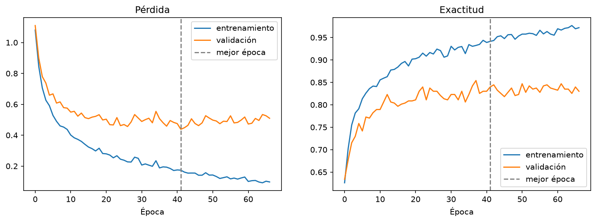
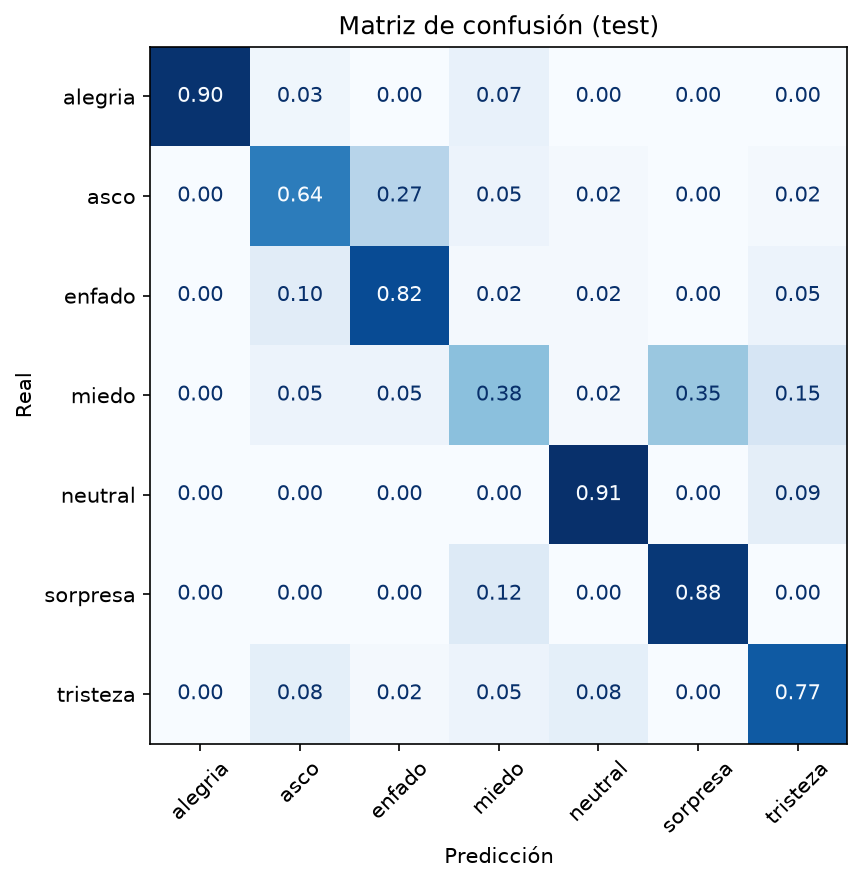

# Práctica 5 · Biometría: Detección y caracterización de caras


---

## Índice

1. [Tarea 1. Simón dice emociones](#tarea-1-simón-dice-emociones)
   - [Entrenamiento](#entrenamiento)
   - [Test](#test)
   - [Filtro](#filtro)
2. [Tarea 2. ¿Qué Windows eres?](#tarea-2-qué-windows-eres)
3. [Creación del entorno](#creación-del-entorno)
4. [Referencias y recursos externos](#referencias-y-recursos-externos)

---

## Tarea 1. Simón dice emociones

Esta tarea consiste en un juego de "Simón dice" controlado con la expresión facial. El juego da órdenes del tipo *"Simón dice: cara de alegría"* y el jugador debe poner esa cara; si la orden no empieza por "Simón dice", el jugador no debe hacerla. Para reconocer la emoción se ha entrenado un modelo propio con el conjunto de datos KDEF, que recibe los puntos de referencia (landmarks) faciales obtenidos con MediaPipe y clasifica la expresión en siete emociones: alegría, tristeza, enfado, sorpresa, miedo, asco y neutral.

El trabajo se divide en dos cuadernos: `Entrenamiento.ipynb`, con la preparación de los datos, el entrenamiento y la evaluación del modelo, y `Filtro_con_entrenamiento.ipynb`, con el juego. El código que comparten ambos (extracción y normalización de los landmarks y la definición de la red) está en la carpeta `utilidades/`, para garantizar que los datos se preparan exactamente igual al entrenar y al jugar.

### Entrenamiento

#### Elección del dataset

Se ha utilizado **KDEF** (*Karolinska Directed Emotional Faces*), que contiene 4.900 imágenes de 70 actores (35 mujeres y 35 hombres, de 20 a 30 años). Cada actor posa las 7 emociones desde 5 ángulos distintos.

Se eligió porque sus etiquetas son fiables, ya que cada una corresponde a la emoción que se pidió posar al actor, y porque las clases están equilibradas e incluyen la expresión neutral, necesaria para las rondas en las que el jugador no debe reaccionar. Además, las fotos se tomaron en un laboratorio con participantes que sabían para qué se iban a utilizar, mientras que la mayoría de las alternativas se construyeron descargando imágenes de internet. Por último, sus expresiones son posadas y exageradas, igual que las que se esperan de un jugador usando el filtro, lo que hace que el conjunto de datos se ajuste bien al modelo.

La licencia de KDEF solo permite su uso en investigación no comercial y prohíbe redistribuirlo, por lo que **ni las imágenes ni los datos derivados de ellas se incluyen en el repositorio**. El conjunto de datos puede descargarse desde [kdef.se](https://www.kdef.se/).

Sus principales limitaciones son el número reducido de personas, la ausencia de gafas, barba y bigote, y la iluminación de estudio, muy distinta a la de una cámara web.

#### Preparación de los datos

La limpieza se realiza con `utilidades/preparar_dataset.py`, que interpreta el nombre de cada imagen (sesión, sexo, número de actor, emoción y ángulo) y genera un índice en CSV sin modificar los archivos originales. 

Primero se descartan los perfiles completos, ya que con la cámara web la cara se ve casi siempre de frente, y se conservan las vistas frontales y los semiperfiles: 2.940 imágenes. También se descartan 2 imágenes cuyo nombre no sigue la codificación de KDEF, por lo que no se conoce su etiqueta, y 4 semiperfiles en los que MediaPipe no detecta la cara. El resultado son **2.934 caras**, con entre 418 y 420 por emoción.

#### Características: landmarks en lugar de imágenes
 
En lugar de entrenar con los píxeles de la imagen, el modelo recibe los **478 landmarks 3D** que devuelve MediaPipe Face Landmarker. La razón es la robustez: un modelo basado en píxeles aprende también la textura de la piel, la iluminación o la zona de los ojos, por lo que podría fallar con gafas, barba o una luz distinta, situaciones que KDEF no contiene. Los landmarks solo describen la geometría de la cara, que apenas cambia por esos factores. MediaPipe se usa únicamente para obtener las coordenadas de los puntos; no se usa ninguna de sus salidas relacionadas con la expresión (*blendshapes*), de modo que todo el reconocimiento de emociones lo aprende el modelo propio.
 
Los landmarks se normalizan para que no dependan de la posición, el tamaño ni la inclinación de la cabeza: se centran en el punto medio entre los ojos, se giran para que la línea de los ojos quede horizontal y se escalan para que la distancia entre ellos valga 1.
 
Se compararon tres formas de construir la entrada:
 
  - **absoluto:** los landmarks normalizados tal cual (1.434 valores).
  - **delta:** los landmarks menos los de la cara neutra de la misma persona, de modo que solo queda el movimiento de la expresión (1.434 valores).
  - **ambos:** la concatenación de las dos anteriores (2.868 valores).

#### División de los datos

Los datos se dividen por persona y no por imagen, para que ninguna persona aparezca a la vez en entrenamiento y evaluación. Si no se hiciera así, el modelo podría reconocer a la persona en lugar de su emoción y los resultados saldrían inflados. Se reparten 50 personas para entrenamiento, 10 para validación y 10 para test, con el mismo número de mujeres y hombres en cada grupo. Los datos se estandarizan con `StandardScaler`, ajustado solo con el conjunto de entrenamiento.

#### Modelo

El clasificador es una **red neuronal densa (MLP)** entrenada desde cero con **PyTorch**.

| Elemento | Valor |
|---|---|
| Arquitectura | Entrada → 512 → 256 → 128 → 7 |
| Capas ocultas | Capa lineal + normalización por lotes + ReLU + desactivación aleatoria de neuronas (*dropout*, 0,4) |
| Parámetros entrenables | 1.635.847 |
| Función de pérdida | Entropía cruzada |
| Optimizador | AdamW (tasa de aprendizaje 1e-3, *weight decay* 1e-3) |
| Tamaño de lote | 64 |
| Aumento de datos | Ruido gaussiano en la entrada (σ = 0,1) |
| Parada | *Early stopping* con paciencia de 25 épocas (máximo 300) |

El ruido en la entrada simula las pequeñas imprecisiones de MediaPipe con la cámara web, y el *dropout*, el *weight decay* y el *early stopping* reducen el sobreajuste.

#### Comparación de características (validación cruzada)

Para elegir el tipo de entrada se realizó una validación cruzada de k particiones (k-fold) con las 60 personas de entrenamiento y validación. Las personas se dividieron en 5 grupos de 12 (6 mujeres y 6 hombres) y se entrenó la red 5 veces, validando cada vez con un grupo distinto y entrenando con los 4 restantes. El resultado final es la media de las 5 rondas. El conjunto de test no se usó en esta comparación.

| Entrada | Exactitud media | F1 medio |
|---|---|---|
| absoluto | 77,2 % ± 3,2 | 76,7 % ± 3,3 |
| delta | 81,8 % ± 3,6 | 81,6 % ± 3,5 |
| **ambos** | **83,0 % ± 2,9** | **82,7 % ± 3,0** |

**Exactitud por ronda**

| Ronda | absoluto | delta | ambos |
|---|---|---|---|
| 1 | 80,8 % | 81,3 % | 84,1 % |
| 2 | 73,2 % | 81,1 % | 81,3 % |
| 3 | 79,6 % | 85,9 % | 86,5 % |
| 4 | 74,9 % | 76,5 % | 78,9 % |
| 5 | 77,5 % | 84,3 % | 84,1 % |

**Exhaustividad media por emoción**

| Entrada | Alegría | Asco | Enfado | Miedo | Neutral | Sorpresa | Tristeza |
|---|---|---|---|---|---|---|---|
| absoluto | 95,8 % | 73,3 % | 71,4 % | 56,1 % | 85,2 % | 88,3 % | 70,2 % |
| delta | 96,7 % | 79,4 % | 73,1 % | 61,4 % | 94,4 % | 88,0 % | 79,9 % |
| ambos | 97,5 % | 78,3 % | 76,7 % | 61,7 % | 94,7 % | 91,1 % | 81,0 % |

**Precisión media por emoción**

| Entrada | Alegría | Asco | Enfado | Miedo | Neutral | Sorpresa | Tristeza |
|---|---|---|---|---|---|---|---|
| absoluto | 93,4 % | 74,0 % | 76,6 % | 70,4 % | 75,5 % | 81,6 % | 71,5 % |
| delta | 96,8 % | 79,6 % | 81,4 % | 70,5 % | 86,4 % | 79,9 % | 79,3 % |
| ambos | 97,3 % | 79,8 % | 79,2 % | 74,3 % | 88,8 % | 81,6 % | 80,2 % |

**F1 medio por emoción**

| Entrada | Alegría | Asco | Enfado | Miedo | Neutral | Sorpresa | Tristeza |
|---|---|---|---|---|---|---|---|
| absoluto | 94,4 % | 73,0 % | 73,1 % | 61,5 % | 79,9 % | 84,4 % | 70,8 % |
| delta | 96,6 % | 79,2 % | 76,8 % | 65,2 % | 90,1 % | 83,7 % | 79,4 % |
| ambos | 97,3 % | 78,9 % | 77,4 % | 67,0 % | 91,5 % | 85,9 % | 80,5 % |

Restar la cara neutra ("delta" y "ambos") mejora el resultado de "absoluto" en las 5 rondas. La mejora más clara se da en la clase neutral, porque una cara seria en reposo deja de confundirse con tristeza. Se eligió **ambos** por obtener la mejor exactitud media y el mejor F1 medio, y porque, al conservar también la cara tal cual, es más tolerante a una calibración imperfecta en el juego.

En el juego, cada métrica tiene una lectura distinta: una exhaustividad baja hace que una emoción pedida con "Simón dice" no se detecte a tiempo, mientras que una precisión baja hace que el modelo vea una emoción que el jugador no ha puesto, lo que en una ronda trampa le haría perder una vida injustamente.

#### Entrenamiento del modelo

Una vez elegida la entrada "ambos", se entrenó el modelo con las 50 personas de entrenamiento, usando las 10 de validación para el *early stopping*. El entrenamiento se detuvo tras 25 épocas seguidas sin mejora en la pérdida de validación, y se conservó el modelo de la mejor época, con una pérdida de validación de 0,438 y una exactitud de validación del 84,0 %.



La mejor época es la 42, en la que la pérdida de validación alcanza su mínimo. A partir de ahí deja de mejorar mientras la de entrenamiento sigue bajando, señal de que el modelo empieza a sobreajustarse. Por eso el *early stopping* detiene el entrenamiento.
 
### Test
 
#### Resultados con KDEF
 
El modelo final se evaluó con las 10 personas de test, que no se usaron en ninguna fase anterior. Obtuvo una **exactitud del 75,8 %**.

La diferencia respecto al k-fold (83 %) se debe al tamaño del conjunto de test: con solo 10 personas, el resultado depende mucho de quiénes son. El k-fold sobre 60 personas es la estimación más estable.
 
| Emoción | Precisión | Exhaustividad | F1 |
|---|---|---|---|
| Alegría | 100,0 % | 90,0 % | 94,7 % |
| Neutral | 86,9 % | 91,4 % | 89,1 % |
| Sorpresa | 71,6 % | 88,3 % | 79,1 % |
| Enfado | 71,0 % | 81,7 % | 76,0 % |
| Tristeza | 71,9 % | 76,7 % | 74,2 % |
| Asco | 70,4 % | 64,4 % | 67,3 % |
| Miedo | 56,1 % | 38,3 % | 45,5 % |
 

 
Las confusiones principales son **miedo con sorpresa** (35 % de los miedos se clasifican como sorpresa) y **asco con enfado** (27 %). Son confusiones esperables: miedo y sorpresa comparten cejas levantadas y ojos muy abiertos, y asco y enfado comparten el ceño fruncido y la tensión alrededor de la nariz. Por ángulo, el modelo acierta un 79,3 % de frente, un 78,6 % en el semiperfil derecho y un 69,3 % en el semiperfil izquierdo.


#### Pruebas con la cámara web

Como el objetivo final es el juego, también se probó el modelo con la cámara web en condiciones reales: con y sin gafas, con luz natural, artificial y tenue. La prueba guiada de `Filtro_con_entrenamiento.ipynb` pide cada emoción por turnos, la mide durante 3 segundos y guarda el porcentaje de fotogramas acertados en `pruebas_webcam/resultados_webcam.csv`. En total se realizaron 21 pruebas con 6 personas de dos rangos de edad: tres de entre 19 y 25 años (personas 1, 4 y 5) y tres de entre 50 y 55 años (personas 2, 3 y 6).

| Emoción | Acierto medio |
|---|---|
| Alegría | 98,1 % |
| Neutral | 90,5 % |
| Enfado | 88,3 % |
| Tristeza | 88,3 % |
| Sorpresa | 68,9 % |
| Miedo | 57,3 % |
| Asco | 35,5 % |

| Persona | Sin gafas | Con gafas |
|---|---|---|
| Persona 1 | 93,2 % | 93,5 % |
| Persona 2 | 81,5 % | 84,0 % |
| Persona 3 | 50,6 % | — |
| Persona 4 | 77,9 % | 73,5 % |
| Persona 5 | 73,4 % | — |
| Persona 6 | 51,8 % | 46,5 % |

Los resultados siguen el mismo patrón que la evaluación con KDEF: alegría, neutral, enfado y tristeza se reconocen bien, mientras que sorpresa, miedo y, sobre todo, asco obtienen los peores resultados. En el caso del asco, la mayoría de los participantes preguntaron cómo poner esa cara, por lo que la dificultad no es solo del modelo, sino también de la propia expresión. Los actores de KDEF, en cambio, ensayaron las expresiones antes de ser fotografiados.

Las gafas no tienen un efecto claro: en cada persona, la diferencia entre llevarlas o no es pequeña y no siempre va en el mismo sentido, lo que respalda el uso de landmarks en lugar de imágenes. Las diferencias entre personas son mayores que las debidas a las gafas. Los peores resultados corresponden a las personas 3 y 6, que tuvieron dificultades para poner las expresiones. Como la persona 2, del mismo rango de edad, no tuvo esos problemas, no es posible separar el efecto de la edad del de la forma de expresar cada emoción.

Estas pruebas son preliminares: el número de personas es reducido, y en algunas sesiones los participantes se reían o apartaban la mirada, lo que afecta sobre todo a la calibración de la cara neutra. Además, una misma persona no siempre ponía la misma cara para una emoción de una prueba a otra, por lo que parte de la variación entre pruebas se debe a la propia expresión y no solo a las condiciones de luz o a las gafas.

### Filtro

El juego se encuentra en `Filtro_con_entrenamiento.ipynb`. Al empezar, el jugador mantiene la cara neutra durante 3 segundos para calibrar el juego: la media de esos fotogramas se guarda como su cara neutra de referencia. Antes de cada orden, el juego espera a que vuelva a poner cara neutra, para que ninguna orden empiece con la expresión de la anterior. Después se elige una emoción al azar, que en el 70 % de los casos va precedida de "Simón dice" y en el 30 % es una trampa. El resultado de cada ronda se indica iluminando el borde de la pantalla en verde o en rojo, y el jugador tiene 3 vidas.

En cada fotograma se detecta la cara con MediaPipe, se normalizan los landmarks igual que en el entrenamiento y el modelo devuelve la probabilidad de cada emoción. Para que un fotograma erróneo no afecte al juego, se promedian las probabilidades de los últimos 10 fotogramas.

#### Reglas y puntuación

  - **Con "Simón dice":** se acierta si la probabilidad de la emoción pedida supera su umbral durante 0,5 segundos seguidos antes de que se acabe el tiempo. Se obtienen 100 puntos, hasta 100 más según la rapidez y 10 por cada acierto seguido.
  - **Trampa:** se pierde una vida si la probabilidad de la emoción mencionada supera su umbral de trampa durante 0,4 segundos seguidos. Si el jugador aguanta hasta el final, obtiene 50 puntos y 10 por cada acierto seguido.

| Emoción | Umbral para acertar | Umbral de trampa |
|---|---|---|
| Alegría, tristeza, enfado, sorpresa | 0,60 | 0,70 |
| Miedo, asco | 0,45 | 0,60 |

Los umbrales de trampa son más altos para que un gesto involuntario o un error puntual del modelo no hagan perder una vida, y miedo y asco tienen umbrales más bajos porque el modelo les asigna probabilidades menores. El tiempo de cada orden empieza en 6 segundos y se reduce 0,3 segundos por ronda hasta un mínimo de 3.

Si aparecen varias personas en la imagen, el juego usa la cara más cercana a la cámara y la marca con un recuadro, y si no se detecta ninguna cara, el juego se pausa para que apartarse de la cámara no sirva para superar una trampa. El juego es de un solo jugador y, como la calibración depende de la persona, debe repetirse al cambiar de jugador.

<div aling="center">
   

https://github.com/user-attachments/assets/a88d460c-6c27-4a3e-8566-c63c962f2395


</div>

#### Controles

  - Tecla `C`: repite la calibración de la cara neutra.
  - Tecla `R`: empieza una partida nueva.
  - Tecla `B`: muestra u oculta las barras con la probabilidad de cada emoción.
  - Tecla `ESC`: cierra el juego.

---

## Tarea 2. ¿Qué Windows eres?

Esta tarea consiste en desarrollar un filtro interactivo basado en el reconocimiento facial, que superpone diferentes imágenes representativas de las versiones de Windows sobre el rostro detectado en tiempo real. Cuando se detecta una cara, se inicia una ruleta que muestra aleatoriamente las distintas versiones de Windows hasta seleccionar una de ellas. Una vez finalizada la selección, la imagen correspondiente se coloca sobre el rostro y se reproduce el sonido característico de dicha versión.

Para implementar el reconocimiento facial se utiliza MediaPipe, concretamente su herramienta **Face Mesh**, que permite detectar numerosos puntos de referencia (landmarks) distribuidos por el rostro. A partir de estos puntos se calcula la posición y las dimensiones de la cara, delimitándola mediante un rectángulo que permite determinar su ubicación dentro de la imagen capturada por la cámara.

Una vez localizada la cara, se emplea OpenCV para procesar los fotogramas de la cámara y superponer sobre la frente de la persona la imagen de la versión de Windows seleccionada. Para ello, se calcula el tamaño adecuado de la imagen en función de las dimensiones del rostro, manteniendo sus proporciones originales y ajustando su posición para conseguir una superposición correcta. Además, se tiene en cuenta el canal alfa de las imágenes, lo que permite conservar la transparencia de los archivos PNG y obtener una integración visual más limpia.

Para evitar que la ruleta se reinicie continuamente mientras el rostro permanece frente a la cámara, se implementa un control sobre la detección facial y las posibles ausencias del rostro. De esta manera, la selección se inicia al detectar una cara y el resultado se mantiene hasta que esta deja de detectarse durante un número determinado de fotogramas.

La selección de la versión de Windows se realiza de forma aleatoria durante un intervalo de tiempo establecido mediante la variable `DURACION_RULETA`. Una vez transcurrido este intervalo, se selecciona aleatoriamente una de las versiones disponibles y se muestra su imagen sobre el rostro. Cada versión tiene asociado un archivo de audio con su sonido característico, cuya reproducción se gestiona mediante *Pygame*. La asociación entre imágenes y sonidos se realiza utilizando el mismo nombre de archivo para ambos recursos.

Adicionalmente se han añadido dos opciones de teclado:

  - Tecla `r`: reinicia la ruleta y permite realizar una nueva selección.
  - Tecla `f`: activa la visualización de los landmarks detectados en el rostro mediante la función `dibujar_landmarks()`.

Para el desarrollo del filtro también se utilizan otros módulos de Python, como **Random**, **OS**, **Glob** y **Time**, que permiten gestionar, respectivamente, la selección aleatoria, el acceso y la organización de archivos, la búsqueda de recursos y el control de los tiempos de ejecución.

Los recursos necesarios para el funcionamiento del filtro se encuentran organizados en dos carpetas: [`fotos`](./fotos), que contiene las imágenes de las diferentes versiones de Windows, y [`audios`](./audios), donde se almacenan sus respectivos sonidos en formato WAV. Para garantizar la correcta asociación entre ambos recursos, cada imagen debe tener un archivo de audio con el mismo nombre.

Por último, todo el código correspondiente al desarrollo e implementación del filtro se encuentra en el archivo [`VC_P5.ipynb`](./VC_P5.ipynb).

<div aling="center">


https://github.com/user-attachments/assets/55a488fd-95b0-461c-a7c5-c23ce7a8c93c


</div>

---

## Creación del entorno

Para ejecutar la práctica, es necesario crear un entorno virtual de Conda con Python 3.11 e instalar las dependencias utilizadas.

```bash
conda create -n environment python=3.11 -y
conda activate environment
python -m pip install torch
python -m pip install mediapipe==0.10.21
python -m pip install pandas scikit-learn matplotlib pygame ipykernel
python -m ipykernel install --user --name environment --display-name "environment"
```

---

## Referencias y recursos externos

Para la realización de esta práctica se han utilizado:
- https://developers.google.com/edge/mediapipe/solutions/vision/face_landmarker 
- https://www.kdef.se/
- https://www.youtube.com/watch?v=Bwm4tZ4fjyk&t=6s

---


<div align="center">

**Práctica 5 · Visión por Computador**

*Universidad de Las Palmas de Gran Canaria · 2026/2027*

</div>

<table align="center">
  <tr>
    <td align="center">
      <a href="https://github.com/AliciaM05">
        
        <br />
        <sub><b>Alicia María Rodríguez Trujillo</b></sub>
      </a>
    </td>
    <td align="center">
      <a href="https://github.com/kilian2113">
        
        <br />
        <sub><b>Kilian Santana Delgado</b></sub>
      </a>
    </td>
  </tr>
</table>
